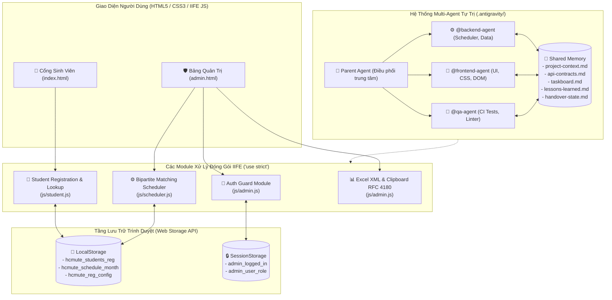

# 🏛️ Hệ Thống Quản Lý & Xếp Lịch Trực Ban Tuyển Sinh HCM-UTE

[](tests/run_all_tests.js)
[](.antigravity/rules.md)
[](https://vtt132109.github.io/tvts/)
[](#)

Ứng dụng web chuyên nghiệp dành cho **Văn phòng Tư Vấn Tuyển Sinh HCM-UTE**, tích hợp thuật toán phân bổ ca trực tối ưu (Bipartite Matching kết hợp luân phiên 4 tuần) và được bảo trợ bởi hệ thống **Multi-Agent Tự Trị Cao Cấp (Autonomous Multi-Agent Architecture)**.

---

## 🏗️ 1. Sơ Đồ Kiến Trúc Hệ Thống (System Architecture)



---

## 📂 2. Cấu Trúc Thư Mục Dự Án (Directory Tree)

```
tvts/
├── index.html                           # Cổng Sinh Viên: Đăng ký ca rảnh & tra cứu lịch trực
├── admin.html                           # Cổng Quản Trị: Xác thực bảo mật, xếp lịch, cấu hình cổng
├── README.md                            # Tài liệu kỹ thuật dự án
├── SECURITY.md                          # Sự cố bảo mật, cách khắc phục & kiểm tra định kỳ
├── package.json                         # npm test / npm run check (không có dependency)
├── database.rules.json                  # Firebase Realtime Database Rules mẫu (chặn truy cập công khai)
├── skills-lock.json                     # Khóa định danh kỹ năng Agent
│
├── css/
│   └── style.css                        # Toàn bộ kiểu dáng, biến màu HCM-UTE, responsive layout
│
├── js/
│   ├── scheduler.js                     # Thuật toán ghép cặp Bipartite Matching & luân phiên 4 tuần
│   ├── month_calendar.js                # Tính lịch 4 tuần hành chính theo tháng/năm bất kỳ
│   ├── cloud_sync.js                    # Đồng bộ hai chiều Firebase REST + phát hiện xung đột + quota guard
│   ├── roster.js                        # Nạp danh sách CTV từ CSV (thay cho sample30.js đã xoá)
│   ├── a11y_modal.js                    # Focus trap, phục hồi focus, Esc đóng modal (accessibility)
│   ├── student.js                       # Logic cổng sinh viên (MSSV-first, lưu ca, tra cứu lịch)
│   └── admin.js                         # Logic quản trị (xác thực, xếp ca, bulk, sự kiện, xuất Excel)
│
├── data/
│   ├── default_students.json            # Danh sách CTV mặc định
│   └── mock_seed_data.json              # Dữ liệu giả lập cho môi trường demo
│   # data/admin_accounts.json ĐÃ XOÁ: không mã nào đọc, từng bị deploy công khai
│
├── tests/                               # 11 bộ kiểm thử tự động — 256 test cases
│   ├── run_all_tests.js                 # Runner kiểm thử tự động toàn diện (CI Harness)
│   ├── scheduler.test.js                # Thuật toán xếp ca & luân phiên 4 tuần
│   ├── auth.test.js                     # Xác thực Admin, phân quyền & mã PIN
│   ├── portal.test.js                   # Đóng/mở cổng & tra cứu MSSV
│   ├── backup.test.js                   # Sao lưu web 6 tháng & auto-pruning
│   ├── payroll_events.test.js           # Bảng chấm công tháng & quản lý sự kiện
│   ├── monthly_registration.test.js     # Đăng ký ca rảnh trọn tháng
│   ├── cloud_sync.test.js               # Đồng bộ đám mây đa thiết bị
│   ├── student_strict_validation.test.js# Xác thực MSSV nghiêm ngặt
│   ├── cloud_persistence.test.js        # Chống ghi đè dữ liệu khi tải lại trang
│   ├── admin_month_navigation.test.js   # Điều hướng tháng & tự động sao lưu
│   └── regression_guard.test.js         # Hồi quy: khóa lại các bug đã sửa
│
├── scripts/
│   ├── clean_code.js                    # Kiểm tra cú pháp, cân bằng thẻ HTML & chạy test
│   └── seed_mock_data.js                # Nạp dữ liệu giả lập cho môi trường demo
│
├── tasks/                               # Kế hoạch & danh sách nhiệm vụ
│   ├── plan.md
│   └── todo.md
│
├── .antigravity/                        # HỆ THỐNG MULTI-AGENT TỰ TRỊ CAO CẤP
│   ├── rules.md                         # 9 giao thức cốt lõi: Memory, Contract-First, Safety Guard...
│   ├── settings.json                    # Cấu hình Auto-approve, Circuit Breaker, Secret Shield, Firewall
│   ├── agents/
│   │   ├── backend-agent.md             # Subagent phụ trách thuật toán, dữ liệu
│   │   ├── frontend-agent.md            # Subagent phụ trách UI/UX, CSS, DOM
│   │   └── qa-agent.md                  # Subagent phụ trách kiểm thử, rà soát chất lượng
│   ├── memory/
│   │   ├── project-context.md           # Tóm tắt kiến trúc hệ thống, tech stack, conventions
│   │   ├── api-contracts.md             # Hợp đồng dữ liệu TypeScript interfaces
│   │   ├── taskboard.md                 # Bảng theo dõi tiến độ công việc trực tiếp (Kanban)
│   │   ├── lessons-learned.md           # Nhật ký tự học hỏi từ lỗi sai (Root Cause -> Action)
│   │   └── handover-state.md            # Bản bàn giao trạng thái phiên làm việc khi chuyển chat
│   └── workflows/
│       ├── rollback.md                  # /rollback: Hủy thay đổi, quay về nhánh cũ an toàn
│       ├── code-review.md               # /code-review: Thẩm định 5 chiều trước khi merge
│       ├── merge-clean.md               # /merge-clean: Chạy test, merge --no-ff, xóa nhánh tạm
│       ├── benchmark.md                 # /benchmark: Đo Big-O Time/Space, phát hiện điểm nghẽn
│       ├── handover.md                  # /handover: Đóng gói trạng thái sang handover-state.md
│       └── init-docs.md                 # /init-docs: Quét hệ thống và tái tạo README.md
│
└── .github/workflows/
    └── static.yml                       # GitHub Actions tự động deploy lên GitHub Pages
```

---

## 🚀 3. Hướng Dẫn Cài Đặt & Sử Dụng Nhanh

### Cách 1: Mở Trực Tiếp Trên Trình Duyệt (Zero Configuration)
Do toàn bộ mã nguồn sử dụng JavaScript thuần bọc IIFE không phụ thuộc bundler hay Node.js server khi chạy:
- Nhấp đúp chuột vào `index.html` để vào **Cổng Sinh Viên**.
- Nhấp đúp chuột vào `admin.html` để vào **Bảng Quản Trị**.
*(Hỗ trợ mọi trình duyệt Chrome, Edge, Firefox, Safari mà không gặp lỗi CORS).*

### Cách 2: Chạy Qua Local Server
```powershell
# Chạy với Python 3
python -m http.server 8000

# Hoặc chạy với Node.js npx serve
npx serve .
```
- Truy cập Cổng Sinh Viên: `http://localhost:8000/index.html`
- Truy cập Cổng Quản Trị: `http://localhost:8000/admin.html`

### Cách 3: Trải Nghiệm Trực Tuyến
- Đã triển khai tự động qua GitHub Pages: **[https://vtt132109.github.io/tvts/](https://vtt132109.github.io/tvts/)**

---

## 🌟 4. Tính Năng Nổi Bật Của Hệ Thống

### 👤 A. Phân Hệ Cổng Sinh Viên (`index.html`)
- **Tự động nhận diện trùng MSSV:** Khi sinh viên nhập MSSV, hệ thống lập tức kiểm tra và tự động nạp lại thông tin Họ tên, SĐT, Phân loại và các ca rảnh đã đăng ký trước đó.
- **Khóa đăng ký an toàn khi cổng đóng:** Khi Ban điều phối khóa cổng hoặc hết thời hạn, form đăng ký sẽ tự động khóa và hiển thị đồng hồ đếm ngược. Sinh viên vẫn tra cứu được thông tin cá nhân và ca trực của mình.
- **Tra cứu ca trực cá nhân:** Nhập MSSV để xem danh sách toàn bộ các ca trực trong tuần kèm tên bạn trực cùng.
- **Đổi ca trực linh hoạt:** Chọn ca muốn nhường và ca mong muốn đổi, hệ thống lưu yêu cầu vào danh sách chờ quản trị viên phê duyệt.
- **Lịch trực dạng agenda trên điện thoại:** Ở màn hình ≤768px, bảng lịch 11 cột được thay bằng danh sách theo ngày (mỗi ngày 2 ca Sáng/Chiều kèm tên + MSSV), đọc dọc bằng một ngón tay thay vì vuốt ngang ~3 màn hình.

### 🛡️ B. Phân Hệ Bảng Quản Trị (`admin.html`)
- **Xác thực bảo mật 2 lớp:**
  - Đăng nhập bằng Tài khoản/Mật khẩu hoặc **Mã PIN Nhanh** (Trưởng ban: `admin` / `0000` / PIN: `9999`; Điều phối: `diephoi` / `0000` / PIN: `8888`).
  - **Chống dò mật khẩu/PIN:** sai 5 lần liên tiếp (đúng định dạng) sẽ tạm khoá 60 giây; gõ nhầm/rỗng không bị tính.
  - **Phiên đăng nhập tự hết hạn sau 12 giờ**, phù hợp máy dùng chung ở văn phòng.
  - Phím tắt mở bí mật từ trang sinh viên: `Ctrl + Shift + A` (hoặc `Cmd + Shift + A`).
- **Thuật toán luân phiên 4 tuần cho 30 CTV (100% Đều Có Ca):**
  - Đảm bảo mỗi ca trực luôn có đúng **2 bạn (1 Cũ + 1 Mới)**.
  - Phân bổ công bằng luân phiên cả 4 tuần, không một sinh viên nào bị bỏ sót.
- **Quản lý thời gian mở cổng đăng ký:** Mở tự do, khóa ngay lập tức, hoặc cài đặt đếm ngược theo thời gian thực (+3 ngày, +5 ngày, +7 ngày).
- **Xuất bảng tính chuẩn mẫu Google Sheets HCM-UTE 2026:**
  - Nút **"📋 Sao Chép Bảng (Ctrl+V vào Google Sheets)"**: Sao chép đồng thời Rich HTML và TSV RFC 4180, chỉ cần bấm `Ctrl + V` vào Google Sheets là giữ nguyên màu sắc, định dạng ô gộp và xuống dòng.
  - Hỗ trợ xuất file `.xls` tương thích Microsoft Excel và `.csv`.

---

## 🤖 5. Hệ Thống Multi-Agent Tự Trị Antigravity (`.antigravity/`)

Dự án được điều phối và bảo trì bởi hệ sinh thái Multi-Agent tự trị với 9 giao thức an toàn:

| Thành Phần | Đường Dẫn / Ký Hiệu | Chức Năng Cốt Lõi |
|---|---|---|
| **Parent Agent** | Điều phối trung tâm | Phân tích ngữ cảnh, kích hoạt Contract-First, bảo hiểm Git trước khi spawn |
| **Backend Agent** | `.antigravity/agents/backend-agent.md` | Chuyên sâu logic Bipartite Matching, cấu trúc JSON/CSV, thư mục `data/` |
| **Frontend Agent** | `.antigravity/agents/frontend-agent.md` | Chuyên sâu giao diện HTML5, CSS3, DOM, Responsive và Dark/Light mode |
| **QA Agent** | `.antigravity/agents/qa-agent.md` | Chuyên sâu kiểm thử tự động, linter, CI test runner, bắt lỗi hồi quy |
| **Shared Memory** | `.antigravity/memory/` | Chứa `project-context.md`, `api-contracts.md`, `taskboard.md`, `lessons-learned.md`, `handover-state.md` |
| **Circuit Breaker** | `settings.json` | Ngắt tự động khi gặp 3 lỗi liên tiếp (Max Retry = 3), chống kẹt vô tận |
| **Secret Shield** | `settings.json` | Khóa cứng quyền truy cập file bí mật: `.env*`, `*.pem`, `*.key`, `.git/**` |
| **Dependency Firewall** | `settings.json` & `rules.md` | Cấm tự ý chạy `npm install *`, ưu tiên tuyệt đối thư viện sẵn có |

### ⚡ Bảng Tra Cứu Lệnh Tắt Workflow (Slash Commands)

| Lệnh Tắt | File Cấu Hình | Tác Vụ Tự Động |
|---|---|---|
| `/rollback` | `.antigravity/workflows/rollback.md` | Hủy thay đổi lỗi, khôi phục working tree và xóa nhánh `agent/*` |
| `/code-review` | `.antigravity/workflows/code-review.md` | Thẩm định 5 chiều (Diff, Cú pháp, XSS, Perf, CI Test) trước khi gộp |
| `/merge-clean` | `.antigravity/workflows/merge-clean.md` | Chạy test lần cuối, merge `--no-ff` vào `main`, tự động xóa nhánh tạm |
| `/benchmark` | `.antigravity/workflows/benchmark.md` | Phân tích Big-O Time & Space, phát hiện điểm nghẽn DOM & LocalStorage |
| `/handover` | `.antigravity/workflows/handover.md` | Đóng gói toàn bộ trạng thái vào `handover-state.md` khi đổi chat |
| `/init-docs` | `.antigravity/workflows/init-docs.md` | Quét toàn bộ mã nguồn và tái tạo `README.md` chuẩn kỹ thuật |

---

## 🧪 6. Bộ Kiểm Thử Tự Động (CI Harness)

Hệ thống tích hợp sẵn bộ kiểm thử hồi quy không phụ thuộc bên ngoài:

```powershell
node tests/run_all_tests.js   # hoặc: npm test
```

### Kết Quả Kiểm Thử (256/256 Tests PASS — 100%)

| # | Bộ Kiểm Thử | Kết Quả |
|---|---|---|
| 1 | Thuật Toán Xếp Ca & Luân Phiên (Scheduler) | 8/8 |
| 2 | Xác Thực, Phân Quyền & Bảo Mật XSS (Auth) | 18/18 |
| 3 | Cổng Sinh Viên: Đóng/Mở & Tra Cứu MSSV (Portal) | 11/11 |
| 4 | Quản Lý Sao Lưu Web 6 Tháng (Backup) | 7/7 |
| 5 | Quản Lý Sự Kiện & Bảng Chấm Công (Payroll) | 31/31 |
| 6 | Đăng Ký Ca Rảnh Trọn Tháng (Monthly Reg.) | 30/30 |
| 7 | Đồng Bộ Đám Mây Đa Thiết Bị (Cloud Sync) | 58/58 |
| 8 | Xác Thực MSSV Nghiêm Ngặt (Strict Validation) | 7/7 |
| 9 | Lưu Trữ Đám Mây & Chống Ghi Đè | 4/4 |
| 10 | Điều Hướng Tháng & Tự Động Sao Lưu | 11/11 |
| 11 | **Hồi Quy: Chống Tái Phát Bug Đã Sửa** | **71/71** |

**Suite 11 (Regression Guard)** là lớp bảo vệ mới, khóa lại các lỗi đã phát hiện và sửa:
- Cổng Sinh Viên **không còn hardcode tháng** — đọc `ACTIVE_MONTH` và sinh ngày tháng động qua `MonthCalendarHelper`.
- `showToast()` **escape HTML** bắt buộc (chống XSS qua tên/MSSV người dùng nhập).
- Cloud Sync phát `ts:data-changed` kèm danh sách key, bắt `QuotaExceededError`, phát hiện xung đột dữ liệu hai chiều.
- Payload lịch tháng **giảm từ 336 KB → 108 KB (-68%)** nhờ bỏ alias trùng lặp và không nhân bản hồ sơ sinh viên.
- Không còn selector chết, `.substr()`, hay định nghĩa trùng `window.*`.
- Không còn tài khoản/mật khẩu thật hay file chứa thông tin cá nhân (PII) trong mã nguồn công khai.

### Kiểm Tra Chất Lượng
```powershell
node scripts/clean_code.js   # Cú pháp + cân bằng thẻ HTML + toàn bộ test
```

---

## 🔐 7. Lưu Ý Bảo Mật

> ⚠️ **Quan trọng:** Đây là ứng dụng web tĩnh, xác thực chạy hoàn toàn phía trình duyệt.
> Mật khẩu và mã PIN mặc định nằm trong mã nguồn công khai, chỉ phù hợp cho môi trường
> nội bộ của Ban Tuyển Sinh.

- **Bắt buộc đổi mật khẩu & PIN** ngay sau lần đăng nhập đầu tiên trên mỗi thiết bị.
  Hệ thống tự hiển thị cảnh báo bảo mật và nhấp nháy nút đổi mật khẩu nếu chưa đổi.
- **Không commit** file CSV/XLSX chứa Họ tên, MSSV, SĐT, số tài khoản ngân hàng — đã chặn trong `.gitignore`.
- **Database Firebase** nên thiết lập Rules chặn ghi từ người lạ và bật xác thực.
- Phím tắt mở trang quản trị từ Cổng Sinh Viên: `Ctrl + Shift + A` (`Cmd + Shift + A` trên macOS).

---

## 📄 Bản Quyền & Phân Phối
Phát triển dành riêng cho Ban Tư Vấn Tuyển Sinh Trường Đại học Sư Phạm Kỹ Thuật TP. Hồ Chí Minh (HCM-UTE). Mọi quyền được bảo lưu.
