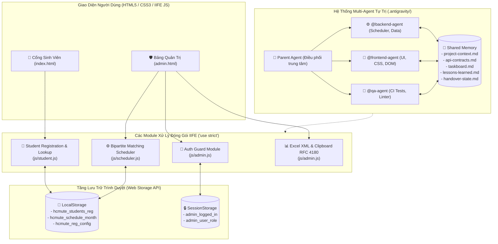

# 🏛️ Hệ Thống Quản Lý & Xếp Lịch Trực Ban Tuyển Sinh HCM-UTE

[](tests/run_all_tests.js)
[](.antigravity/rules.md)
[](https://vtt132109.github.io/tvts/)
[](#)

Ứng dụng web chuyên nghiệp dành cho **Văn phòng Tư Vấn Tuyển Sinh HCM-UTE**, tích hợp thuật toán phân bổ ca trực tối ưu (Bipartite Matching kết hợp luân phiên 4 tuần) và được bảo trợ bởi hệ thống **Multi-Agent Tự Trị Cao Cấp (Autonomous Multi-Agent Architecture)**.

---

## 🏗️ 1. Sơ Đồ Kiến Trúc Hệ Thống (System Architecture)



---

## 📂 2. Cấu Trúc Thư Mục Dự Án (Directory Tree)

```
tvts/
├── index.html                           # Cổng Sinh Viên: Đăng ký ca rảnh & tra cứu lịch trực
├── admin.html                           # Cổng Quản Trị: Xác thực bảo mật, xếp lịch, cấu hình cổng
├── README.md                            # Tài liệu kỹ thuật dự án
├── SECURITY.md                          # Sự cố bảo mật, cách khắc phục & kiểm tra định kỳ
├── package.json                         # npm test / npm run check (không có dependency)
├── database.rules.json                  # Firebase Rules 3 nhánh dữ liệu + /staff và /staff_emails
├── skills-lock.json                     # Khóa định danh kỹ năng Agent
│
├── css/
│   └── style.css                        # Toàn bộ kiểu dáng, biến màu HCM-UTE, responsive layout
│
├── js/
│   ├── scheduler.js                     # Thuật toán ghép cặp Bipartite Matching & luân phiên 4 tuần
│   ├── month_calendar.js                # Tính lịch 4 tuần hành chính theo tháng/năm bất kỳ
│   ├── cloud_sync.js                    # Firebase: Google/Anonymous Auth, 3 nhánh dữ liệu, yêu cầu sinh viên
│   ├── roster.js                        # Nạp danh sách CTV từ CSV (thay cho sample30.js đã xoá)
│   ├── a11y_modal.js                    # Focus trap, phục hồi focus, Esc đóng modal (accessibility)
│   ├── student.js                       # Logic cổng sinh viên (MSSV-first, lưu ca, tra cứu lịch)
│   └── admin.js                         # Logic quản trị (xác thực, xếp ca, bulk, sự kiện, xuất Excel)
│
├── data/
│   └── ds-ctv.csv                       # Danh sách 58 CTV thật (cục bộ, KHÔNG commit vì chứa PII)
│   # default_students.json & mock_seed_data.json ĐÃ XOÁ: dữ liệu mẫu cũ,
│   # danh sách chuẩn giờ nhập từ CSV qua Admin → Sinh Viên → Nhập CSV
│   # data/admin_accounts.json ĐÃ XOÁ: không mã nào đọc, từng bị deploy công khai
│
├── tests/                               # 18 bộ kiểm thử tự động — 532 test cases
│   ├── run_all_tests.js                 # Runner kiểm thử tự động toàn diện (CI Harness)
│   ├── scheduler.test.js                # Thuật toán xếp ca & luân phiên 4 tuần
│   ├── auth.test.js                     # Xác thực Admin, thiết lập lần đầu & mã PIN
│   ├── portal.test.js                   # Đóng/mở cổng & tra cứu MSSV
│   ├── shift_history.test.js            # Lịch sử ca trực nhiều tháng
│   ├── audit.test.js                    # Nhật ký thao tác quản trị
│   ├── store.test.js                    # IndexedDB & khôi phục localStorage
│   ├── common.test.js                   # Tiện ích dùng chung
│   ├── backup.test.js                   # Sao lưu web 6 tháng & auto-pruning
│   ├── payroll_events.test.js           # Bảng chấm công tháng & quản lý sự kiện
│   ├── monthly_registration.test.js     # Đăng ký ca rảnh trọn tháng
│   ├── cloud_sync.test.js               # Cloud guard, dữ liệu công khai, yêu cầu ẩn danh & Rules
│   ├── student_strict_validation.test.js# Xác thực MSSV nghiêm ngặt
│   ├── cloud_persistence.test.js        # Chống ghi đè dữ liệu khi tải lại trang
│   ├── admin_month_navigation.test.js   # Điều hướng tháng & tự động sao lưu
│   ├── credential_sync_e2e.test.js      # E2E: cấp quyền máy A, đăng nhập máy B (hash)
│   ├── csv_import.test.js               # Validate CSV, trùng MSSV, vai trò
│   ├── student_portal_bugs.test.js      # Năm tuần 4, lịch tháng trước, a11y modal
│   ├── regression_guard.test.js         # Hồi quy: khóa lại các bug đã sửa
│   └── fixtures/roster_sample.csv       # CSV tổng hợp cho test (không PII)
│
├── scripts/
│   └── clean_code.js                    # Kiểm tra cú pháp, cân bằng thẻ HTML & chạy test
│
├── tasks/                               # Kế hoạch & danh sách nhiệm vụ
│   ├── plan.md
│   └── todo.md
│
├── .antigravity/                        # HỆ THỐNG MULTI-AGENT TỰ TRỊ CAO CẤP
│   ├── rules.md                         # 9 giao thức cốt lõi: Memory, Contract-First, Safety Guard...
│   ├── settings.json                    # Cấu hình Auto-approve, Circuit Breaker, Secret Shield, Firewall
│   ├── agents/
│   │   ├── backend-agent.md             # Subagent phụ trách thuật toán, dữ liệu
│   │   ├── frontend-agent.md            # Subagent phụ trách UI/UX, CSS, DOM
│   │   └── qa-agent.md                  # Subagent phụ trách kiểm thử, rà soát chất lượng
│   ├── memory/
│   │   ├── project-context.md           # Tóm tắt kiến trúc hệ thống, tech stack, conventions
│   │   ├── api-contracts.md             # Hợp đồng dữ liệu TypeScript interfaces
│   │   ├── taskboard.md                 # Bảng theo dõi tiến độ công việc trực tiếp (Kanban)
│   │   ├── lessons-learned.md           # Nhật ký tự học hỏi từ lỗi sai (Root Cause -> Action)
│   │   └── handover-state.md            # Bản bàn giao trạng thái phiên làm việc khi chuyển chat
│   └── workflows/
│       ├── rollback.md                  # /rollback: Hủy thay đổi, quay về nhánh cũ an toàn
│       ├── code-review.md               # /code-review: Thẩm định 5 chiều trước khi merge
│       ├── merge-clean.md               # /merge-clean: Chạy test, merge --no-ff, xóa nhánh tạm
│       ├── benchmark.md                 # /benchmark: Đo Big-O Time/Space, phát hiện điểm nghẽn
│       ├── handover.md                  # /handover: Đóng gói trạng thái sang handover-state.md
│       └── init-docs.md                 # /init-docs: Quét hệ thống và tái tạo README.md
│
└── .github/workflows/
    └── static.yml                       # GitHub Actions tự động deploy lên GitHub Pages
```

---

## 🚀 3. Hướng Dẫn Cài Đặt & Sử Dụng Nhanh

### Cách 1: Mở Trực Tiếp Trên Trình Duyệt (Zero Configuration)
Do toàn bộ mã nguồn sử dụng JavaScript thuần bọc IIFE không phụ thuộc bundler hay Node.js server khi chạy:
- Nhấp đúp chuột vào `index.html` để vào **Cổng Sinh Viên**.
- Nhấp đúp chuột vào `admin.html` để vào **Bảng Quản Trị**.
*(Hỗ trợ mọi trình duyệt Chrome, Edge, Firefox, Safari mà không gặp lỗi CORS).*

### Cách 2: Chạy Qua Local Server
```powershell
# Chạy với Python 3
python -m http.server 8000

# Hoặc chạy với Node.js npx serve
npx serve .
```
- Truy cập Cổng Sinh Viên: `http://localhost:8000/index.html`
- Truy cập Cổng Quản Trị: `http://localhost:8000/admin.html`

### Cách 3: Trải Nghiệm Trực Tuyến
- Đã triển khai tự động qua GitHub Pages: **[https://vtt132109.github.io/tvts/](https://vtt132109.github.io/tvts/)**

---

## 🌟 4. Tính Năng Nổi Bật Của Hệ Thống

### 👤 A. Phân Hệ Cổng Sinh Viên (`index.html`)
- **Tự động nhận diện trùng MSSV:** Khi sinh viên nhập MSSV, hệ thống lập tức kiểm tra và tự động nạp lại thông tin Họ tên, SĐT, Phân loại và các ca rảnh đã đăng ký trước đó.
- **Khóa đăng ký an toàn khi cổng đóng:** Khi Ban điều phối khóa cổng hoặc hết thời hạn, form đăng ký sẽ tự động khóa và hiển thị đồng hồ đếm ngược. Sinh viên vẫn tra cứu được thông tin cá nhân và ca trực của mình.
- **Tra cứu ca trực cá nhân:** Nhập MSSV để xem danh sách toàn bộ các ca trực trong tuần kèm tên bạn trực cùng.
- **Đổi ca trực linh hoạt:** Chọn ca muốn nhường và ca mong muốn đổi, hệ thống lưu yêu cầu vào danh sách chờ quản trị viên phê duyệt.
- **Lịch trực dạng agenda trên điện thoại:** Ở màn hình ≤768px, bảng lịch 11 cột được thay bằng danh sách theo ngày (mỗi ngày 2 ca Sáng/Chiều kèm tên + MSSV), đọc dọc bằng một ngón tay thay vì vuốt ngang ~3 màn hình.

### 🛡️ B. Phân Hệ Bảng Quản Trị (`admin.html`)
- **Xác thực bảo mật 2 lớp:**
  - **Thiết lập lần đầu:** máy chưa có tài khoản cán bộ sẽ hiện form tạo **Trưởng ban** (mật khẩu ≥ 8 ký tự, PIN 6 số). Không còn mật khẩu/PIN mặc định trong mã nguồn.
  - **Chống dò mật khẩu/PIN:** sai 5 lần liên tiếp (đúng định dạng) sẽ tạm khoá 60 giây; gõ nhầm/rỗng không bị tính.
  - **Phiên đăng nhập tự hết hạn sau 12 giờ**, phù hợp máy dùng chung ở văn phòng.
  - Phím tắt mở bí mật từ trang sinh viên: `Ctrl + Shift + A` (hoặc `Cmd + Shift + A`).
- **Thuật toán luân phiên 4 tuần cho 58 CTV (100% Đều Có Ca):**
  - Đảm bảo mỗi ca trực luôn có đúng **2 bạn (1 Cũ + 1 Mới)**.
  - Phân bổ công bằng luân phiên cả 4 tuần, không một sinh viên nào bị bỏ sót.
- **Quản lý thời gian mở cổng đăng ký:** Mở tự do, khóa ngay lập tức, hoặc cài đặt đếm ngược theo thời gian thực (+3 ngày, +5 ngày, +7 ngày).
- **Xuất bảng tính chuẩn mẫu Google Sheets HCM-UTE 2026:**
  - Nút **"📋 Sao Chép Bảng (Ctrl+V vào Google Sheets)"**: Sao chép đồng thời Rich HTML và TSV RFC 4180, chỉ cần bấm `Ctrl + V` vào Google Sheets là giữ nguyên màu sắc, định dạng ô gộp và xuống dòng.
  - Hỗ trợ xuất file `.xls` tương thích Microsoft Excel và `.csv`.

---

## 🤖 5. Hệ Thống Multi-Agent Tự Trị Antigravity (`.antigravity/`)

Dự án được điều phối và bảo trì bởi hệ sinh thái Multi-Agent tự trị với 9 giao thức an toàn:

| Thành Phần | Đường Dẫn / Ký Hiệu | Chức Năng Cốt Lõi |
|---|---|---|
| **Parent Agent** | Điều phối trung tâm | Phân tích ngữ cảnh, kích hoạt Contract-First, bảo hiểm Git trước khi spawn |
| **Backend Agent** | `.antigravity/agents/backend-agent.md` | Chuyên sâu logic Bipartite Matching, cấu trúc JSON/CSV, thư mục `data/` |
| **Frontend Agent** | `.antigravity/agents/frontend-agent.md` | Chuyên sâu giao diện HTML5, CSS3, DOM, Responsive và Dark/Light mode |
| **QA Agent** | `.antigravity/agents/qa-agent.md` | Chuyên sâu kiểm thử tự động, linter, CI test runner, bắt lỗi hồi quy |
| **Shared Memory** | `.antigravity/memory/` | Chứa `project-context.md`, `api-contracts.md`, `taskboard.md`, `lessons-learned.md`, `handover-state.md` |
| **Circuit Breaker** | `settings.json` | Ngắt tự động khi gặp 3 lỗi liên tiếp (Max Retry = 3), chống kẹt vô tận |
| **Secret Shield** | `settings.json` | Khóa cứng quyền truy cập file bí mật: `.env*`, `*.pem`, `*.key`, `.git/**` |
| **Dependency Firewall** | `settings.json` & `rules.md` | Cấm tự ý chạy `npm install *`, ưu tiên tuyệt đối thư viện sẵn có |

### ⚡ Bảng Tra Cứu Lệnh Tắt Workflow (Slash Commands)

| Lệnh Tắt | File Cấu Hình | Tác Vụ Tự Động |
|---|---|---|
| `/rollback` | `.antigravity/workflows/rollback.md` | Hủy thay đổi lỗi, khôi phục working tree và xóa nhánh `agent/*` |
| `/code-review` | `.antigravity/workflows/code-review.md` | Thẩm định 5 chiều (Diff, Cú pháp, XSS, Perf, CI Test) trước khi gộp |
| `/merge-clean` | `.antigravity/workflows/merge-clean.md` | Chạy test lần cuối, merge `--no-ff` vào `main`, tự động xóa nhánh tạm |
| `/benchmark` | `.antigravity/workflows/benchmark.md` | Phân tích Big-O Time & Space, phát hiện điểm nghẽn DOM & LocalStorage |
| `/handover` | `.antigravity/workflows/handover.md` | Đóng gói toàn bộ trạng thái vào `handover-state.md` khi đổi chat |
| `/init-docs` | `.antigravity/workflows/init-docs.md` | Quét toàn bộ mã nguồn và tái tạo `README.md` chuẩn kỹ thuật |

---

## 🧪 6. Bộ Kiểm Thử Tự Động (CI Harness)

Hệ thống tích hợp sẵn bộ kiểm thử hồi quy không phụ thuộc bên ngoài:

```powershell
node tests/run_all_tests.js   # hoặc: npm test
```

### Kết Quả Kiểm Thử (532/532 Tests PASS — 18 bộ, 100%)

| # | Bộ Kiểm Thử | Kết Quả |
|---|---|---|
| 1 | Thuật Toán Xếp Ca & Luân Phiên (Scheduler) | 8/8 |
| 2 | Xác Thực, Thiết Lập Lần Đầu & Bảo Mật XSS (Auth) | 24/24 |
| 3 | Cổng Sinh Viên: Đóng/Mở & Tra Cứu MSSV (Portal) | 11/11 |
| 4 | Lịch Sử Ca Trực Nhiều Tháng (Shift History) | 12/12 |
| 5 | Nhật Ký Thao Tác Quản Trị (Audit Log) | 23/23 |
| 6 | IndexedDB & Khôi Phục Dữ Liệu (Store) | 19/19 |
| 7 | Tiện Ích Dùng Chung (Common) | 13/13 |
| 8 | Quản Lý Sao Lưu Web 6 Tháng (Backup) | 7/7 |
| 9 | Quản Lý Sự Kiện & Bảng Chấm Công (Payroll) | 31/31 |
| 10 | Đăng Ký Ca Rảnh Trọn Tháng (Monthly Reg.) | 30/30 |
| 11 | Cloud Sync, Guard, Dữ Liệu Công Khai & Rules | 240/240 |
| 12 | Xác Thực MSSV Nghiêm Ngặt (Strict Validation) | 7/7 |
| 13 | Lưu Trữ Đám Mây & Chống Ghi Đè | 5/5 |
| 14 | Điều Hướng Tháng & Tự Động Sao Lưu | 11/11 |
| 15 | Đồng Bộ Tài Khoản Cán Bộ Giữa Hai Máy (E2E) | 4/4 |
| 16 | Nhập CSV, Trùng MSSV & Vai Trò (CSV Import) | 8/8 |
| 17 | Năm Tuần 4, Lịch Tháng Trước & A11y Modal | 7/7 |
| 18 | **Hồi Quy: Chống Tái Phát Bug Đã Sửa** | **72/72** |

**Cloud Sync (Suite 11)** khóa các hành vi an toàn mới:
- Preflight `updatedAt` trước khi PATCH; chặn xung đột từ thiết bị khác và chặn danh sách CTV/tài khoản cán bộ teo bất thường (có `force` sau khi xác nhận).
- Chỉ PATCH các key thực sự đổi; không bao giờ gửi `students`/`adminUsers` rỗng.
- `tvts_requests/swaps` chỉ staff hoặc chủ sở hữu đọc; trạng thái đổi ca công khai nằm ở `tvts_public.swapStatuses` (không lý do, không tên, không uid).
- Trang sinh viên chỉ kéo trạng thái đổi ca từ nhánh công khai, không tải toàn bộ yêu cầu.

**Suite 16 (CSV)** chặn trùng MSSV, thiếu cột Họ tên/MSSV, cảnh báo thiếu cột vai trò/mã ca lạ; fixture tổng hợp nằm trong `tests/fixtures/roster_sample.csv`.

**Suite 18 (Regression Guard)** khóa lại các lỗi đã phát hiện và sửa:
- Cổng Sinh Viên **không còn hardcode tháng** — đọc `ACTIVE_MONTH` và sinh ngày tháng động qua `MonthCalendarHelper`.
- `showToast()` **escape HTML** bắt buộc (chống XSS qua tên/MSSV người dùng nhập).
- Cloud Sync phát `ts:data-changed` kèm danh sách key, bắt `QuotaExceededError`, phát hiện xung đột dữ liệu hai chiều.
- Payload lịch tháng **giảm từ 336 KB → 108 KB (-68%)** nhờ bỏ alias trùng lặp và không nhân bản hồ sơ sinh viên.
- Không còn selector chết, `.substr()`, hay định nghĩa trùng `window.*`.
- Không còn tài khoản/mật khẩu thật hay file chứa thông tin cá nhân (PII) trong mã nguồn công khai.

### Kiểm Tra Chất Lượng
```powershell
node scripts/clean_code.js   # Cú pháp + cân bằng thẻ HTML + toàn bộ test
```

> Workflow deploy `static.yml` có job `test` và `deploy.needs: test`: test hoặc
> `clean_code` thất bại thì GitHub Pages **không** nhận bản deploy mới. Ngoài ra
> bước quét bí mật chặn PIN/mật khẩu hardcode ở cả 3 dạng key (`"pin":`, `'pin':`,
> `pin:`) trong JS được publish.

---

## 🔐 7. Kiến Trúc Dữ Liệu & Bảo Mật

### 7.1 Ba nhánh Firebase

| Nhánh | Quyền đọc | Quyền ghi | Nội dung |
|---|---|---|---|
| `tvts_production_data` | Cán bộ có UID trong `/staff` hoặc email trong `/staff_emails` | Cán bộ có UID trong `/staff` hoặc email trong `/staff_emails` | Danh sách đầy đủ, lịch, tài khoản (hash), sao lưu |
| `tvts_public` | Mọi người (kể cả chưa đăng nhập) | Cán bộ có UID trong `/staff` hoặc email trong `/staff_emails` | Bản rút gọn **không PII** + lịch công khai |
| `tvts_requests` | Cán bộ (toàn bộ); sinh viên đọc đúng yêu cầu của mình theo `uid`; trạng thái đổi ca công khai ở `tvts_public.swapStatuses` | Sinh viên tạo/sửa yêu cầu gắn `uid`; cán bộ nhận ca rảnh tự động, duyệt đổi ca | Đăng ký ca & đề xuất đổi ca |

> `/staff` chỉ ghi được trong Firebase Console (`.write: false`). `/staff_emails` do **cán bộ đã có quyền** ghi ngay trong app (nút Cấp Quyền), giá trị phải là boolean `true`.
> Email key phải viết thường và thay **tất cả** dấu chấm bằng `%2E`, ví dụ `ten@gmail%2Ecom`.
> Rules chỉ chấp nhận tài khoản Google đã xác thực email (`email_verified === true`, `sign_in_provider === 'google.com'`).
> `database.rules.json` đã điền sẵn email Google của Trưởng ban. Nếu đổi người giữ quyền khởi động, sửa **cả 10 chỗ** trong file trước khi Publish. Sau đó cấp quyền cho người khác ngay trong app.

### 7.2 Đăng nhập

- **Cán bộ:** đăng nhập **Google** ngay trên màn hình xác thực admin (nút **Đăng nhập bằng Google**, luôn mở bảng chọn tài khoản). Tài khoản phải có **UID trong `/staff`** hoặc **email trong `/staff_emails`** mới đọc/ghi được dữ liệu riêng tư. Không còn tài khoản Firebase Email/Password dùng chung trên UI.
- **Cấp quyền trong app (không cần Console):** `Admin → ☁️ Trung tâm đồng bộ → 👥 Cấp Quyền Cán Bộ Theo Email` → nhập email → **Cấp Quyền**. App ghi `staff_emails/<email đã mã hoá> = true`; người đó chỉ cần đăng nhập Google bằng đúng email ấy, không cần lấy UID. Danh sách bên dưới cho phép **thu hồi** (🗑️) bất cứ lúc nào.
- **Sinh viên:** **không có trang đăng nhập**. Chỉ nhập MSSV; app tự tạo phiên **Anonymous** để gửi yêu cầu. Sinh viên không cần tài khoản Google/email.
- **Ca rảnh không chờ duyệt:** sau khi cán bộ đăng nhập Google, app tự kéo `tvts_requests/registrations` và gộp ngay vào danh sách CTV; **không tự xếp lịch**. Cán bộ xem tổng **Lượt ca rảnh đã đăng ký** trên dashboard rồi bấm xếp ca khi sẵn sàng. Đề xuất đổi ca vẫn chờ cán bộ duyệt.
- **Tài khoản nội bộ (username/PIN)** dùng để mở bảng quản trị trên máy trực. Máy chưa có tài khoản sẽ hiện **Thiết lập lần đầu**; không còn tài khoản/mật khẩu/PIN mặc định. Nếu quên mật khẩu, đăng nhập **Google cán bộ** (nếu Cloud đã cấu hình) rồi cấp lại quyền, hoặc khôi phục từ bản sao lưu JSON. Google là lớp kiểm soát dữ liệu Cloud.
- **Web API Key** là mã công khai phía client. Cán bộ nhập một lần trong modal Cloud; app công bố nó trong `tvts_public/clientConfig` để máy sinh viên tạo được phiên ẩn danh.

#### Quy trình ca rảnh (không chờ duyệt)

1. Sinh viên nhập MSSV, chọn ca rảnh và bấm lưu. App ghi yêu cầu vào `tvts_requests/registrations/<mssv>` với `status: "registered"`.
2. Cán bộ bấm **Đăng nhập bằng Google** ở màn hình admin. App kiểm tra UID trong `/staff/<uid>` hoặc email trong `/staff_emails/<email đã mã hóa>`, sau đó tự kéo yêu cầu.
3. Ca rảnh được **gộp ngay** vào danh sách CTV; dashboard cập nhật thẻ **Lượt ca rảnh đã đăng ký** và cột **Rảnh N ca** của từng người.
4. Cán bộ xem dữ liệu rồi chủ động bấm **⚡ Xếp Ca Nhanh** (hoặc nút xếp lịch tháng). App **không tự xếp lịch, không tự ghi đè** lịch đã có.
5. Đề xuất **đổi ca** vẫn nằm trong hàng chờ để cán bộ duyệt riêng vì ảnh hưởng lịch đã công bố.

---

### 7.3 Cấu hình Firebase bắt buộc (một lần)

1. **Authentication → Sign-in method:** bật **Google** và **Anonymous**.
2. **Authentication → Settings → Authorized domains:** thêm tên miền GitHub Pages (ví dụ `vtt132109.github.io`).
3. **Realtime Database → Data:** thêm `staff/<UID Google của quản trị chính>: true`. Để cấp quyền trước cho người khác, thêm `staff_emails/<email đã mã hóa>: true` (email viết thường, thay dấu chấm bằng `%2E`, ví dụ `ten@gmail%2Ecom`). Chỉ dùng boolean `true`, không dùng chuỗi `"true"` hay object.
4. **Realtime Database → Rules:** dán toàn bộ `database.rules.json` (3 nhánh dữ liệu + `/staff`, `/staff_emails`) rồi **Publish**. Rules cho phép mỗi tài khoản đã đăng nhập chỉ đọc đúng UID hoặc email của mình để app xác minh quyền cán bộ.
5. **Project settings → General → Web API Key:** dán vào modal Cloud của admin → **Lưu Cấu Hình**. Sau đó có thể bấm **Đăng nhập bằng Google** ngay ở màn hình xác thực admin (hoặc trong modal Cloud).
6. Bấm **Đẩy Lên Cloud** một lần để tạo `tvts_public` cho trang sinh viên.

> ⚠️ Nếu chưa Publish rules mới, sinh viên sẽ không gửi được yêu cầu và trang sinh viên không có dữ liệu công khai.

> ⚠️ **Quan trọng:** Đây là ứng dụng web tĩnh, phần mở bảng quản trị chạy phía trình duyệt.
> Mật khẩu/PIN nội bộ mặc định nằm trong mã nguồn công khai, chỉ phù hợp cho môi trường
> nội bộ của Ban Tuyển Sinh.

- **Thiết lập lần đầu** tài khoản `Trưởng ban` ngay trên máy trống: mật khẩu ≥ 8 ký tự, PIN 6 số, không dùng mật khẩu mặc định.
- **Không commit** file CSV/XLSX chứa Họ tên, MSSV, SĐT, số tài khoản ngân hàng — đã chặn trong `.gitignore`.
- **Firebase:** dữ liệu công khai chỉ chứa MSSV/họ tên/vai trò/ca rảnh; SĐT, email, ngân hàng và hash mật khẩu chỉ nằm trong `tvts_production_data` (cán bộ).
- Phím tắt mở trang quản trị từ Cổng Sinh Viên: `Ctrl + Shift + A` (`Cmd + Shift + A` trên macOS).

### 🔑 Cấp quyền & dùng tài khoản trên máy khác

Cán bộ được cấp quyền ở **máy A** đăng nhập được ngay ở **máy B** — không cần thao tác thêm.

- **Tạo tài khoản:** `Admin → 🔑 Cấp Quyền & Đổi MK → Thêm Cán Bộ` (Họ tên, Username, Vai trò, Mật khẩu, PIN).
- **Máy B:** mở `admin.html`, nhập đúng username + mật khẩu (hoặc PIN) vừa cấp. Không cần tạo lại.
- **Đổi mật khẩu/PIN** ở máy nào cũng có hiệu lực ở các máy khác sau lần đồng bộ kế tiếp.
- **Bảo mật:** mật khẩu/PIN chỉ rời máy dưới dạng **hash có muối** (SHA-256 + salt ngẫu nhiên, 3.000 vòng lặp). Database lộ cũng không đọc được mật khẩu. Tài khoản cũ còn lưu plaintext sẽ tự được băm ngay sau lần đăng nhập đầu tiên.

> ⚠️ **Điều kiện bắt buộc:** Firebase Rules phải **chặn ghi từ người lạ**. Nếu database còn mở, kẻ tấn công có thể chèn tài khoản vào `tvts_production_data/adminUsers` hoặc sửa dữ liệu công khai. Luôn Publish `database.rules.json` trước khi dùng. Xem [SECURITY.md](SECURITY.md).
>
> ⚠️ File sao lưu JSON vẫn chứa mật khẩu/PIN dạng thô (dùng để khôi phục khẩn cấp). Giữ trên USB/Drive riêng, không để trong thư mục dự án. `.gitignore` đã chặn `*-sao-luu-*.json` và `backup-*.json`.

---

## 📄 Bản Quyền & Phân Phối
Phát triển dành riêng cho Ban Tư Vấn Tuyển Sinh Trường Đại học Sư Phạm Kỹ Thuật TP. Hồ Chí Minh (HCM-UTE). Mọi quyền được bảo lưu.
