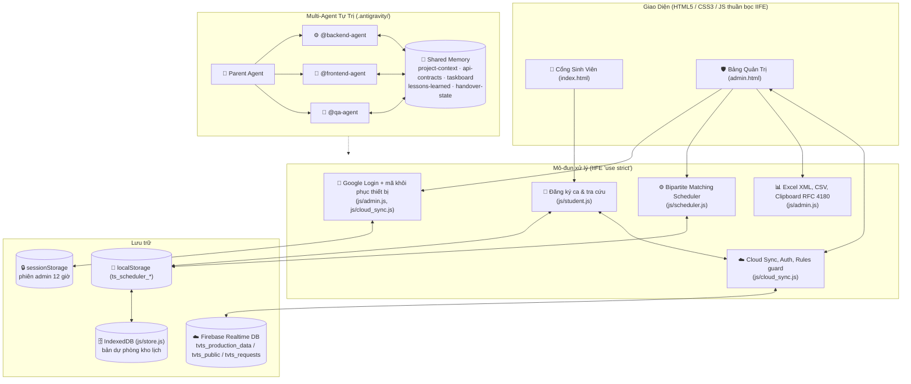

# 🏛️ Hệ Thống Quản Lý & Xếp Lịch Trực Ban Tuyển Sinh HCM-UTE

[](tests/run_all_tests.js)
[](tests/e2e/smoke.spec.js)
[](.antigravity/rules.md)
[](https://vtt132109.github.io/tvts/)
[](#)

Ứng dụng web tĩnh dành cho **Văn phòng Tư Vấn Tuyển Sinh HCM-UTE**: cộng tác viên (CTV) tự đăng ký ca rảnh theo tháng, cán bộ xếp lịch trực 4 tuần bằng thuật toán ghép cặp cực đại (Bipartite Matching) có cân bằng số ca, rồi xuất bảng chấm công. Dữ liệu đồng bộ qua Firebase Realtime Database; mã nguồn được bảo trì bởi hệ **Multi-Agent tự trị** (`.antigravity/`).

> Tài liệu liên quan: [SECURITY.md](SECURITY.md) (hồ sơ sự cố & kiểm tra bảo mật) · [.antigravity/memory/](.antigravity/memory/) (bộ nhớ kiến trúc, hợp đồng dữ liệu, nhật ký bài học).

---

## 🗓️ 1. Chế Độ Xếp Lịch Theo Tháng (cập nhật 01/11/2026)

Trong Quản trị, chọn **Chế độ xếp lịch của tháng** (cạnh nút xếp lịch) rồi bấm **Tự động phân bổ lịch**. Lựa chọn được lưu theo tháng cùng cấu hình số người/ca và đồng bộ Cloud.

| Số người/ca | Chế độ |
|---|---|
| 1 người | Không phân biệt Cũ/Mới · Ưu tiên người Mới · Random |
| 2 người | **1 Mới + 1 Cũ (mặc định)** · Không phân biệt Cũ/Mới · Random |

- **1 Mới + 1 Cũ:** mỗi ca ghép một người Cũ với một người Mới (chỉ có ở mức 2 người/ca).
- **Không phân biệt:** cân bằng số ca giữa các CTV, không xét vai trò.
- **Ưu tiên người Mới (chỉ 1 người/ca):** dành ít nhất 1 ca/tháng cho mỗi người Mới có ca rảnh phù hợp trước, rồi mới xếp người Cũ; người Cũ có thể không có ca. Ghép ca trên cả tháng (không lặp quota mỗi tuần); ca đã gán tay được tính khi dành suất. Nếu còn thiếu người Mới, giao diện cảnh báo và nêu rõ danh sách cần xử lý.
- **Random:** chọn ngẫu nhiên trong những người đăng ký rảnh, không ưu tiên vai trò hay số ca.
- Mọi chế độ **chỉ xếp vào đúng ca rảnh của đúng tuần** (tuần Firebase trả `null`/thiếu key = 0 ca), **giữ nguyên ô gán tay**, tránh xếp một người 2 ca cùng ngày khi còn lựa chọn khác, và hiển thị ô thiếu kèm cảnh báo khi không đủ người.

**Kết quả phân bổ** hiển thị riêng số CTV Mới/Cũ có ca trên số người từng nhóm đã đăng ký, cùng số chỗ trực cơ bản của tháng (đếm từ lịch thực tế sau gán tay). Ví dụ: 1 người/ca × 10 ca/tuần × 4 tuần = 40 chỗ, không thể tự xếp đủ 42 người khác nhau nếu không tăng số người/ca hoặc gán thêm người.

**Tag Cũ/Mới** hiển thị trong bảng *Quản lý sinh viên* và *Thống kê số ca* của admin; **không** xuất hiện trong ô lịch trực, bản in hay cổng sinh viên.

**Hồ sơ tháng:** cạnh thanh chuyển tháng có nút **📋 Hồ sơ tháng** để xem danh sách CTV, số người đã/chưa đăng ký ca và số ca trực từng người. Trước khi sang tháng mới, hệ thống lưu cả danh sách và ca rảnh của tháng cũ (kể cả tháng chưa xếp lịch). Bảng chấm công và sao lưu của tháng cũ dùng danh sách đã chốt. Dữ liệu đi cùng kho lịch lên Cloud và được lưu dự phòng trong IndexedDB; nếu không lưu được, hệ thống dừng chuyển tháng để giữ đăng ký cũ. Tháng trước đây chưa lưu danh sách sẽ báo thiếu hồ sơ, không suy đoán người chưa đăng ký.

**Lọc đăng ký:** trong *Quản lý sinh viên*, khối thống kê có bộ lọc **Tất cả / Đã đăng ký ca / Chưa đăng ký ca** kèm số lượng, tính theo ca rảnh của tháng đang xem (0 ca = chưa đăng ký) và kết hợp với tìm kiếm tên/MSSV.

---

## 🏗️ 2. Sơ Đồ Kiến Trúc Hệ Thống



---

## 📂 3. Cấu Trúc Thư Mục

```
tvts/
├── index.html                  # Cổng Sinh Viên: đăng ký ca rảnh, tra cứu lịch, đổi ca
├── admin.html                  # Cổng Quản Trị: xếp lịch, CTV, chấm công, sao lưu, Cloud
├── README.md · SECURITY.md     # Tài liệu kỹ thuật · hồ sơ & kiểm tra bảo mật
├── package.json                # npm test / check / test:e2e (devDependency duy nhất: Playwright)
├── playwright.config.js        # Cấu hình test trình duyệt (server tĩnh cổng 8137)
├── database.rules.json         # Firebase Rules: 3 nhánh dữ liệu + /staff, /staff_emails
├── firebase.json · .firebaserc # Cấu hình Firebase CLI (project vtt123-76e07)
│
├── css/style.css               # Toàn bộ kiểu dáng, biến màu HCM-UTE, dark/light, responsive
│
├── js/
│   ├── scheduler.js            # Bipartite Matching, chế độ xếp lịch, luân phiên 4 tuần
│   ├── month_calendar.js       # Lịch 4 tuần hành chính (T2–T6) theo tháng/năm bất kỳ
│   ├── cloud_sync.js           # Firebase REST: Google/Anonymous Auth, App Check, 3 nhánh, yêu cầu SV
│   ├── store.js                # IndexedDB: bản dự phòng kho lịch & khôi phục khi localStorage mất
│   ├── audit.js                # Nhật ký thao tác quản trị (tối đa 200 bản ghi)
│   ├── common.js               # Tiện ích dùng chung (định dạng ngày, đếm ngược)
│   ├── roster.js               # Danh sách CTV nạp từ CSV (không còn dữ liệu mẫu nhúng sẵn)
│   ├── a11y_modal.js           # Focus trap, phục hồi focus, Esc đóng modal
│   ├── student.js              # Logic cổng sinh viên (MSSV-first, lưu ca, tra cứu, đổi ca)
│   └── admin.js                # Logic quản trị (đăng nhập, xếp ca, gán tay, bulk, hồ sơ tháng, xuất file)
│
├── data/ds-ctv.csv             # Danh sách CTV thật — cục bộ, KHÔNG commit (chứa PII)
│
├── tests/                      # 21 bộ kiểm thử — 706 test cases
│   ├── run_all_tests.js        # Runner tổng (CI harness)
│   ├── *.test.js               # scheduler, auth, portal, shift_history, audit, store, common,
│   │                           # app_check, local_lockout, manual_assignment, backup, payroll_events,
│   │                           # monthly_registration, cloud_sync, student_strict_validation,
│   │                           # cloud_persistence, admin_month_navigation, credential_sync_e2e,
│   │                           # csv_import, student_portal_bugs, regression_guard
│   ├── e2e/                    # Playwright: smoke.spec.js (15 test), server.js, fixtures.js
│   └── fixtures/               # roster_sample.csv (tổng hợp, không PII), test_students.js
│
├── scripts/
│   ├── clean_code.js           # Kiểm tra cú pháp, cân bằng thẻ HTML, chạy toàn bộ test
│   └── khoi_phuc_58.js         # Khôi phục danh sách CTV trên Firebase (có kiểm tra, không ghi danh sách rỗng)
│
├── tasks/                      # plan.md, todo.md — kế hoạch giai đoạn thiết kế lại admin (đã hoàn tất)
│
├── .antigravity/               # HỆ THỐNG MULTI-AGENT TỰ TRỊ
│   ├── rules.md                # 10 giao thức: Memory, Taskboard, Lessons, Contract-First, Git guard, Circuit breaker...
│   ├── settings.json · ignore  # Auto-approve, Secret Shield, Dependency Firewall, bộ lọc ngữ cảnh
│   ├── agents/                 # backend-agent · frontend-agent · qa-agent
│   ├── memory/                 # project-context · api-contracts · taskboard · lessons-learned · handover-state
│   └── workflows/              # rollback · code-review · merge-clean · benchmark · handover ·
│                               # init-docs · seed-data · clean-project
│
└── .github/workflows/
    ├── ci.yml                  # Test (Node 20/22) + E2E Playwright trên mỗi push/PR
    └── static.yml              # Test + E2E → quét bí mật → deploy GitHub Pages
```

> `.agents/` (kỹ năng agent bên thứ ba), `full-stack-preset/` và mọi file `*.csv`/`*.xlsx` (trừ `tests/fixtures/roster_sample.csv`) đã bị chặn trong `.gitignore`.

---

## 🚀 4. Cài Đặt & Chạy

**Mở trực tiếp:** nhấp đúp `index.html` (Cổng Sinh Viên) hoặc `admin.html` (Quản Trị) — chạy được qua `file:///`, nhưng đăng nhập Google/Cloud cần chạy qua server hoặc bản đã deploy.

**Local server:**
```powershell
python -m http.server 8000      # hoặc: npx serve .
# http://localhost:8000/index.html   |   http://localhost:8000/admin.html
```

**Bản trực tuyến:** [https://vtt132109.github.io/tvts/](https://vtt132109.github.io/tvts/) (tự deploy qua GitHub Actions sau khi qua test).

**Kiểm thử:**
```powershell
npm test            # node tests/run_all_tests.js  — 706 test, không cần cài thêm gì
npm run check       # node scripts/clean_code.js   — cú pháp + thẻ HTML + toàn bộ test
npm ci ; npx playwright install chromium ; npm run test:e2e   # 15 test trình duyệt
```
> Test `6.10` (Regression Guard) gọi `git ls-files`; chạy trong thư mục không phải kho git sẽ báo lỗi 1 test dù code đúng.

---

## 🌟 5. Tính Năng

### 👤 A. Cổng Sinh Viên (`index.html`)
- **MSSV-first:** chưa nhập MSSV thì khoá chọn ca; nhập MSSV hợp lệ trong danh sách thì mở khoá và nạp lại ca đã đăng ký. MSSV lạ bị từ chối.
- **Đăng ký ca rảnh trọn tháng:** 4 tuần × 10 ca, hiển thị ngày dương lịch cụ thể; cho phép đăng ký **0 ca**, có nút xoá ca tuần này/cả tháng và sao chép tuần ra cả tháng.
- **Khoá an toàn khi cổng đóng:** form tự khoá và đếm ngược; vẫn tra cứu được lịch và ca của mình.
- **Tra cứu & lịch sử ca:** xem ca trực của bản thân, kèm tên người trực cùng; xem lịch tháng trước và lịch sử nhiều tháng. Trên điện thoại (≤768px) lịch hiển thị dạng agenda theo ngày thay cho bảng 11 cột.
- **Đổi ca / nhờ trực hộ:** gửi yêu cầu vào hàng chờ để cán bộ duyệt; trạng thái công khai không chứa lý do hay tên.
- **Không hiển thị vai trò:** cổng sinh viên tuyệt đối không có nhãn Cũ/Mới (chỉ admin thấy).

### 🛡️ B. Bảng Quản Trị (`admin.html`)
- **Đăng nhập:** chỉ **Google** (tài khoản phải có UID trong `/staff` hoặc email trong `/staff_emails`). Đăng nhập bằng username/mật khẩu/PIN cục bộ **đã bị gỡ khỏi sản phẩm**; hash còn sót của bản cũ được xoá một lần. Khi Google lỗi hoặc mất mạng có **mã khôi phục thiết bị** (12 ký tự, lưu hash + salt, chỉ dùng được trên máy đã tạo, tạo sau khi đã đăng nhập; phiên này chỉ làm việc với dữ liệu cục bộ và **không đẩy Cloud**). Sai 5 lần liên tiếp tạm khoá 60 giây; phiên hết hạn sau 12 giờ; cờ `sessionStorage` giả không mở được dashboard. Phím tắt mở trang quản trị từ trang sinh viên: `Ctrl + Shift + A` (`Cmd + Shift + A`).
- **Xếp lịch:** xem mục 1. Có thể **gán tay** bất kỳ ô nào cho mọi CTV (kể cả người chưa đăng ký); hệ thống cảnh báo khi chưa đăng ký, trái vai trò, trùng ca cùng ngày — admin xác nhận thì vẫn gán. Gán tay thực hiện ngay trên lưới lịch (không có nút riêng); nếu tháng chưa có lịch, app tự tạo khung 4 tuần × 10 ca trống.
- **Quản lý CTV:** bảng có tag Cũ/Mới, chọn nhiều và thao tác hàng loạt (đổi vai trò, xoá ca, xoá khỏi hệ thống), xoá ca từng người, bộ lọc đăng ký, duyệt yêu cầu MSSV mới.
- **Nhập CSV:** CSV danh sách CTV (kiểm tra thiếu cột, trùng MSSV, vai trò lạ) **và** CSV phản hồi Google Form (ánh xạ lựa chọn "dd/mm (Thứ X) — Sáng/Chiều" vào đúng tuần/ca của tháng đang mở; ngày của tháng khác bị bỏ qua).
- **Hồ sơ tháng, chấm công, sao lưu:** bảng chấm công tháng (công trực văn phòng 4 tuần), sao lưu web tối đa 6 bản/180 ngày với tự dọn, xuất/nhập sao lưu JSON, nhật ký thao tác.
- **Cổng đăng ký:** mở tự do, khoá ngay, hoặc hẹn giờ (+3/+5/+7 ngày) kèm đếm ngược.
- **Xuất bảng tính chuẩn mẫu HCM-UTE:** *Sao chép bảng* (Rich HTML + TSV RFC 4180, dán thẳng vào Google Sheets giữ màu và ô gộp), xuất `.xls` và `.csv`, in.
- **Trung tâm đồng bộ Cloud:** đăng nhập Google, kéo/đẩy dữ liệu, cấp/thu hồi quyền cán bộ theo email, **Giải phóng MSSV** khỏi phiên ẩn danh cũ, nhập App Check site key.

---

## 🤖 6. Hệ Thống Multi-Agent Antigravity (`.antigravity/`)

| Thành phần | Đường dẫn | Chức năng |
|---|---|---|
| **Parent Agent** | — | Điều phối, Contract-First, bảo hiểm Git trước khi spawn |
| **Backend Agent** | `agents/backend-agent.md` | Thuật toán xếp ca, cấu trúc dữ liệu |
| **Frontend Agent** | `agents/frontend-agent.md` | HTML/CSS/DOM, responsive, dark/light |
| **QA Agent** | `agents/qa-agent.md` | Kiểm thử, linter, bắt hồi quy |
| **Shared Memory** | `memory/` | `project-context`, `api-contracts`, `taskboard`, `lessons-learned`, `handover-state` |
| **Circuit Breaker** | `settings.json` | Ngắt sau 3 lần lỗi liên tiếp |
| **Secret Shield** | `settings.json` | Cấm đọc/sửa `.env*`, `*.pem`, `*.key`, `.git/**` |
| **Dependency Firewall** | `settings.json`, `rules.md` | Cấm tự `npm install` |

| Lệnh | Tác vụ |
|---|---|
| `/rollback` | Huỷ thay đổi lỗi, khôi phục working tree, xoá nhánh `agent/*` |
| `/code-review` | Thẩm định 5 chiều (diff, cú pháp, XSS, hiệu năng, test) |
| `/merge-clean` | Test lần cuối, merge `--no-ff` vào `main`, xoá nhánh tạm |
| `/benchmark` | Phân tích Big-O, điểm nghẽn DOM & localStorage |
| `/handover` | Đóng gói trạng thái vào `handover-state.md` khi đổi phiên |
| `/init-docs` | Quét mã nguồn, tái tạo README |
| `/seed-data` | Nạp danh sách CTV thật từ `data/ds-ctv.csv` (cục bộ) để thử trên localhost |
| `/clean-project` | Dọn biến thừa, dead code, `console.log` tạm và chuẩn hoá mã nguồn |

---

## 🧪 7. Bộ Kiểm Thử (706/706 PASS — 21 bộ)

| # | Bộ kiểm thử | Test |
|---|---|:---:|
| 1 | Thuật toán xếp ca & luân phiên (Scheduler) | 21 |
| 2 | Xác thực, phân quyền & bảo mật XSS (Auth) | 25 |
| 3 | Cổng sinh viên: đóng/mở & tra cứu MSSV (Portal) | 11 |
| 4 | Lịch sử ca trực nhiều tháng (Shift History) | 12 |
| 5 | Nhật ký thao tác quản trị (Audit Log) | 23 |
| 6 | IndexedDB & khôi phục dữ liệu (Store) | 23 |
| 7 | Tiện ích dùng chung & chống lệch module (Common) | 13 |
| 8 | Firebase App Check & header bảo vệ REST | 6 |
| 9 | Bỏ login cục bộ & mã khôi phục thiết bị (Local Lockout) | 12 |
| 10 | Gán ca thủ công & xếp tự động phải né (Manual Assignment) | 46 |
| 11 | Sao lưu web 6 tháng (Backup) | 7 |
| 12 | Sự kiện & bảng chấm công tháng (Payroll) | 31 |
| 13 | Đăng ký ca rảnh trọn tháng & hiển thị ngày (Monthly Registration) | 30 |
| 14 | Đồng bộ đám mây, guard, dữ liệu công khai & Rules (Cloud Sync) | 315 |
| 15 | Xác thực MSSV nghiêm ngặt (Strict Validation) | 7 |
| 16 | Lưu trữ đám mây & chống ghi đè khi tải lại (Cloud Persistence) | 5 |
| 17 | Điều hướng tháng & tự động sao lưu (Admin Month Navigation) | 14 |
| 18 | Đồng bộ tài khoản cán bộ giữa hai máy (Credential Sync E2E) | 4 |
| 19 | Nhập CSV, trùng MSSV & cảnh báo vai trò (CSV Import) | 14 |
| 20 | Năm tuần 4, lịch tháng trước & a11y modal (Portal Bug Guards) | 11 |
| 21 | **Hồi quy: chống tái phát bug đã sửa (Regression Guard)** | **76** |

Cộng thêm **15 test trình duyệt** (Playwright, `tests/e2e/smoke.spec.js`): cờ phiên giả không mở được dashboard, duyệt yêu cầu MSSV, đổi 1 người/ca, xoá người khỏi ca, nhập CSV, khoá tháng, sửa ca rảnh theo tuần, mobile không tràn ngang, chọn chế độ xếp lịch, ưu tiên người Mới, lọc đăng ký, tuần `null` từ Cloud, hồ sơ tháng cũ, tag vai trò và cảnh báo thiếu người Mới.

**Những gì các bộ test khoá lại:**
- **Cloud Sync:** preflight `updatedAt` trước khi PATCH; chặn xung đột và danh sách CTV teo bất thường (có `force` sau khi xác nhận); chỉ PATCH key thay đổi, không bao giờ gửi `students`/`adminUsers` rỗng; push thất bại thì cảnh báo rõ và giữ `localUpdatedAt` để lần kéo sau hỏi trước khi ghi đè; `tvts_requests/swaps` chỉ staff hoặc chủ sở hữu đọc, trạng thái đổi ca công khai ở `tvts_public.swapStatuses`.
- **CSV:** chặn trùng MSSV, thiếu cột Họ tên/MSSV, cảnh báo thiếu cột vai trò hoặc mã ca lạ.
- **Regression Guard:** cổng sinh viên không hardcode tháng; `showToast()` escape HTML; Cloud Sync bắt `QuotaExceededError` và phát hiện xung đột hai chiều; payload lịch tháng giảm 336 KB → 108 KB; không còn selector chết/`.substr()`/định nghĩa `window.*` trùng; không có tài khoản, mật khẩu hay PII trong mã nguồn công khai.

**CI/CD:** `ci.yml` chạy test (Node 20, 22) + `clean_code` + E2E trên mỗi push/PR. `static.yml` có job `test` và `e2e` với `deploy.needs`, nên test đỏ thì GitHub Pages **không** nhận bản mới; trước khi publish còn kiểm mọi `<script src="js/…">` tồn tại và quét chặn PIN/mật khẩu hardcode (`"pin":`, `'pin':`, `pin:`) trong JS được xuất bản.

---

## 🔐 8. Kiến Trúc Dữ Liệu & Bảo Mật

### 8.1 Ba nhánh Firebase

| Nhánh | Đọc | Ghi | Nội dung |
|---|---|---|---|
| `tvts_production_data` | Cán bộ (UID trong `/staff` hoặc email trong `/staff_emails`) | Cán bộ | Danh sách CTV đầy đủ, lịch, sự kiện, sao lưu |
| `tvts_public` | Mọi người (kể cả chưa đăng nhập) | Cán bộ | Bản rút gọn **không PII** + lịch công khai + trạng thái đổi ca + `clientConfig` |
| `tvts_requests` | Cán bộ (toàn bộ); sinh viên đọc đúng yêu cầu của mình theo `uid` | Sinh viên ghi yêu cầu gắn `uid` của mình; cán bộ duyệt | `registrations`, `swaps`, `mssv_owner` (giữ chỗ MSSV theo phiên ẩn danh) |

> `/staff` chỉ ghi được trong Firebase Console (`.write: false`). `/staff_emails` chỉ **email chủ sở hữu** (Trưởng ban, hardcode trong Rules) mới ghi được — cấp quyền bằng nút trong app; giá trị phải là boolean `true`, key là email viết thường với **mọi** dấu chấm thay bằng `%2E` (ví dụ `ten@gmail%2Ecom`).
> Rules chỉ chấp nhận tài khoản Google đã xác thực email (`email_verified === true`, `sign_in_provider === 'google.com'`).
> Email chủ sở hữu xuất hiện ở **13 chỗ** trong `database.rules.json`; nếu đổi người giữ quyền khởi động hãy tìm–thay toàn bộ trước khi Publish.
> Điều khoản "bootstrap" từng cho bất kỳ tài khoản Google nào tự cấp quyền khi `/staff_emails` trống đã bị gỡ (28/10).

### 8.2 Đăng nhập & quyền

- **Cán bộ:** nút **Đăng nhập bằng Google** ở màn hình xác thực admin (luôn mở bảng chọn tài khoản). Không còn tài khoản Firebase Email/Password dùng chung và không còn mật khẩu/PIN cục bộ.
- **Cấp quyền trong app (không cần Console):** `Admin → ☁️ Trung tâm đồng bộ → 👥 Cấp Quyền Cán Bộ Theo Email` → nhập email → **Cấp Quyền** (chỉ chủ sở hữu thực hiện được). Danh sách bên dưới cho phép thu hồi (🗑️).
- **Mã khôi phục thiết bị:** xem mục 5B; dùng khi Google lỗi, không phải kênh đăng nhập thường ngày.
- **Sinh viên:** không có trang đăng nhập, chỉ nhập MSSV; app tự tạo phiên **Anonymous**, lưu refresh token ở `ts_anon_session_v1` để giữ nguyên `uid` khi tải lại. Nếu MSSV bị khoá vào phiên cũ (đổi máy, xoá dữ liệu trình duyệt), cán bộ bấm **🔓 Giải Phóng MSSV**; cán bộ Google đăng ký hộ vẫn không bị chặn.
- **Role theo trang:** `admin.html` khai báo `tvts-cloud-role=admin`, `index.html` khai báo `student`; role không lưu vào config Cloud dùng chung.
- **Web API Key** là mã công khai phía client; cán bộ nhập một lần trong modal Cloud và app công bố vào `tvts_public/clientConfig`. **Firebase App Check** (reCAPTCHA v3) là tuỳ chọn — dán site key trong modal Cloud, xem [SECURITY.md](SECURITY.md) mục 9.

#### Quy trình ca rảnh (không chờ duyệt)
1. Sinh viên nhập MSSV, chọn ca, lưu → ghi `tvts_requests/registrations/<mssv>` với `status: "registered"`.
2. Cán bộ đăng nhập Google → app kiểm tra quyền và tự kéo yêu cầu (nút **📥 Kéo Ca Rảnh & Yêu Cầu** khi cần kéo tay).
3. Ca rảnh được gộp ngay vào danh sách CTV; dashboard cập nhật **Lượt ca rảnh đã đăng ký**.
4. Cán bộ chủ động bấm xếp lịch. App **không tự xếp, không tự ghi đè** lịch đã có.
5. Đề xuất **đổi ca** vẫn chờ cán bộ duyệt vì ảnh hưởng lịch đã công bố.

### 8.3 Cấu hình Firebase bắt buộc (một lần)

1. **Authentication → Sign-in method:** bật **Google** và **Anonymous**.
2. **Authentication → Settings → Authorized domains:** thêm tên miền GitHub Pages (ví dụ `vtt132109.github.io`).
3. **Realtime Database → Data:** thêm `staff/<UID Google của quản trị chính>: true`. Có thể cấp trước cho người khác bằng `staff_emails/<email đã mã hoá>: true` (chỉ giá trị boolean).
4. **Realtime Database → Rules:** dán toàn bộ `database.rules.json` rồi **Publish** (hoặc `firebase deploy --only database`). Rules đã Publish lần đầu 2026-10-24; các đợt sửa 28/10 (gỡ bootstrap) và 29/10 (`mssv_owner`) **cần Publish lại nếu chưa làm**.
5. **Project settings → General → Web API Key:** dán vào modal Cloud của admin → **Lưu Cấu Hình**, đăng nhập Google.
6. Bấm **Đẩy Lên Cloud** một lần để tạo `tvts_public` cho trang sinh viên.

> ⚠️ Chưa Publish Rules đúng bản thì sinh viên không gửi được yêu cầu, hoặc dữ liệu riêng tư có thể bị lộ. Kiểm tra định kỳ bằng các lệnh trong [SECURITY.md](SECURITY.md) mục 6.

### 8.4 Quy tắc dữ liệu cá nhân

- **Không commit** CSV/XLSX chứa Họ tên, MSSV, SĐT, email, số tài khoản (đã chặn trong `.gitignore`).
- Nhánh công khai chỉ chứa MSSV, họ tên, vai trò, ca rảnh, lịch; SĐT, email, ngân hàng chỉ nằm ở `tvts_production_data`. Lịch/sự kiện được quét sạch PII ở mọi cấp, và đã bỏ `deviceId` cùng bản trùng `allMonths` khỏi payload công khai.
- File sao lưu JSON chứa toàn bộ danh sách CTV kèm thông tin liên hệ: giữ trên USB/Drive riêng, không để trong thư mục dự án (`.gitignore` đã chặn `*-sao-luu-*.json`, `backup-*.json`).
- Việc còn treo (đổi mật khẩu/PIN từng lộ trong lịch sử git, thu hồi email staff cũ, có/không viết lại lịch sử git): xem [SECURITY.md](SECURITY.md) mục 11 "P0 credential rotation".

---

## 📄 Bản Quyền & Phân Phối
Phát triển dành riêng cho Ban Tư Vấn Tuyển Sinh Trường Đại học Sư Phạm Kỹ Thuật TP. Hồ Chí Minh (HCM-UTE). Mọi quyền được bảo lưu.
